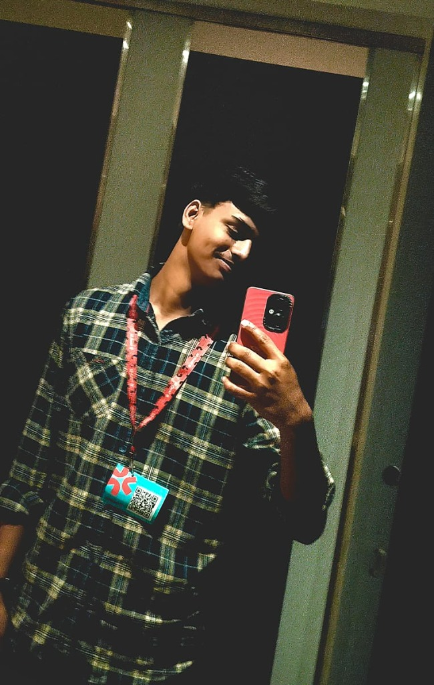

# Shivam Gawande — 3D Personal Universe & Portfolio

> An award-level, cinematic 3D personal digital universe built for **Shivam Gawande**, Computer Science Diploma student at Cusrow Wadia Institute of Technology (CWIT) and aspiring AI/Software Developer.



## 🌌 Overview

This website is a futuristic WebGL / Three.js interactive digital universe inspired by high-craft creative developer portfolios. It features a dark, cinematic visual language, interactive particle reconstructions, 3D physics, real-time mouse parallax, multi-page sector navigation, and an interactive 3D AI Core.

### 🚀 Key Highlights

- **Multi-Page Cinematic Architecture**: 7 interconnected sectors (`01 Home`, `02 About`, `03 Projects`, `04 Skills`, `05 Journey`, `06 Achievements`, `07 Contact`) with camera transitions and keyboard shortcuts (`1-7`, `ArrowLeft`/`ArrowRight`).
- **Creative Digital Identity Element**: Real-time canvas particle reconstruction of Shivam's photos (`shivam_badge.jpg` & `shivam_outdoor.png`) that dynamically disperses with spring physics on cursor proximity, with 4 cyber modes (`Particles`, `Dither`, `Wireframe`, `Glitch`).
- **Signature 3D AI Core**: Multifaceted crystalline nucleus with counter-rotating quantum orbital rings, orbiting data satellites, and reactive click pulses.
- **Adaptive Custom Cursor**: Smooth lerp tracking with dynamic contextual badges (`VIEW`, `OPEN`, `3D`, `POINTER`).
- **3D Skills Universe**: Rotating planetary nodes orbiting a central neural core across Programming, Web Dev, AI, and Computer Science fundamentals.
- **3D Projects Showcase**: Interactive case studies for:
  - **TransitOS**: AI-powered transportation management platform.
  - **AOS – AI for CA**: Autonomous AI assistant automating repetitive CA workflows.
  - **ATM Management System**: Robust C++ OOP console financial engine.
  - **RoyalRide**: Luxury car rental management system with normalized database integration.
- **Dramatic 3D Achievements Section**: Interactive 3D Hackathon Trophy celebrating competitive sprint wins.
- **Secret Easter Egg**: Type `shivam` on your keyboard to trigger the `AI CORE OVERLOAD` sequence!

---

## 🛠️ Tech Stack

- **Framework**: React 19 + TypeScript + Vite
- **3D Engine**: Three.js + WebGL Canvas
- **Styling**: Tailwind CSS v4 + Custom Cyberpunk / Glassmorphism Design Tokens
- **Motion & Animations**: Framer Motion + Canvas Confetti
- **Audio**: Custom Web Audio API synthesizer (no external audio files required)
- **Icons**: Lucide React + Custom SVG Icons

---

## 🏃 Getting Started

### Prerequisites

- Node.js (v18+)
- npm or pnpm

### Installation

```bash
# Clone the repository
git clone https://github.com/gawandeshiv71-oss/portfolio.git

# Enter project directory
cd portfolio

# Install dependencies
npm install

# Start development server
npm run dev
```

### Production Build

```bash
# Build optimized production bundle
npm run build

# Preview production build locally
npm run preview
```

---

## 📬 Contact & Connect

- **Developer**: Shivam Gawande
- **Institution**: Cusrow Wadia Institute of Technology (CWIT), Pune
- **Email**: [shivamgawande082@gmail.com](mailto:shivamgawande082@gmail.com)
- **Phone**: [+91 8010439347](tel:8010439347)
- **GitHub**: [github.com/gawandeshiv71-oss](https://github.com/gawandeshiv71-oss)
- **LinkedIn**: [linkedin.com/in/shivam-gawande-1a0752384](https://www.linkedin.com/in/shivam-gawande-1a0752384)

---

© 2026 Shivam Gawande. Crafted with modern web technologies.

